<div align="center">



<!-- quests:start -->

<a href="https://github.com/thomassems/MyWorkoutApp"></a> <a href="https://github.com/vibhutirp/asterism"></a>

<a href="https://github.com/catou88/GoDatabase"></a> <a href="https://github.com/catou88/butterflai2"></a>

<a href="https://github.com/chuddrw/CalHacks26"></a> <a href="https://github.com/catou88/hackathon-2026-official"></a>

<a href="https://github.com/catou88/SlackRetrieval"></a> <a href="https://github.com/catou88/LegalLibrary"></a>

<!-- quests:end -->

</div>

<details>
<summary><b>How this profile works</b></summary>

<br>

Every graphic above is a plain SVG file drawn entirely from rectangles by a small Python generator. They use no web fonts, no JavaScript and no third-party stats service, so GitHub renders them as is. The animation is CSS keyframes inside the SVG, and it switches off for viewers who set `prefers-reduced-motion`.

#### Repository layout

| Path | Purpose |
|---|---|
| `profile.json` | Everything you edit by hand: name, role, loadout, achievements, hackathon counts and the list of quests (islands). |
| `scripts/pixel.py` | A tiny pixel-art toolkit: a 5×7 bitmap font, sprite drawing, and a `Canvas` that merges pixels into one `<path>` per colour to keep the files small. |
| `scripts/gen.py` | Renders `assets/hud.svg` (player card), `assets/quest-map.svg` (blimp tour and contribution city) and `assets/quests/` (one card per island, plus the header and footer strips) from `profile.json` and `data/stats.json`. It also rewrites the card grid between the `<!-- quests:start -->` and `<!-- quests:end -->` markers in this README. |
| `scripts/fetch_stats.py` | Calls the GitHub GraphQL API and writes `data/stats.json`: lifetime contributions, commits, PRs, repos contributed to and the last 52 weeks of activity. |
| `.github/workflows/profile.yml` | Runs fetch, then render, then commit. It runs daily at 09:17 UTC, on manual dispatch, and on pushes that touch `profile.json` or `scripts/`. |
| `assets/` | The generated SVGs. Don't edit these by hand, because the next run overwrites them. |
| `assets/quests/NN.svg` | Quest cards. Each card shows the same island and icon as its spot on the banner, in the same order, and links to the quest's `repo`. |
| `data/stats.json` | Created by the workflow on its first run. It is committed so that local renders can reuse it. |
| `SETUP.md` | A short checklist for first-time setup. |

#### Data flow

```
GitHub GraphQL API ──fetch_stats.py──▶ data/stats.json ─┐
                                                        ├─gen.py──▶ assets/hud.svg
profile.json ───────────────────────────────────────────┘          assets/quest-map.svg
```

#### How the numbers are calculated

- **Level** = `floor(sqrt(lifetime contributions / 2)) + 1`. The XP bar shows the progress toward the next level.
- **Lifetime contributions / commits** are summed over every year listed in `contributionYears`. Commits also include `restrictedContributionsCount` (private contributions). That count is only non-zero when the workflow uses a personal token, `PROFILE_TOKEN`.
- **Collab repos** counts repositories you don't own that you contributed commits, PRs or repos to.
- **Hackathon wins, hackathon entries and team projects** come from `manual_stats` in `profile.json`, because GitHub can't count these.
- **City skyline**: one building per week. Height scales with `(week / busiest week)^0.8`, and the busiest week gets an antenna. Until `data/stats.json` exists, the skyline is procedural and the live tiles show `--`.

#### Editing quests

Each entry in `quests` becomes one island. Islands are visited left to right, and anything past 5 wraps onto a second row.

```json
{ "name": "ALGODB LAB", "tech": "GO + NEXT.JS",
  "blurb": "B+Tree store in Go with a visualizer for the WAL, buffer pool and disk",
  "tag": "B+TREE ENGINE", "icon": "database", "repo": "https://github.com/catou88/GoDatabase" }
```

- **Icons:** `dumbbell`, `database`, `star`, `trophy`, `magnifier`, `badge`, `butterfly`, `book`, `beacon`. Any other name falls back to `beacon`.
- **Tag colours:** `WINNER` is gold, `CO-OP` is pink, `HACKATHON` is cyan, and anything else is mint. `NOW BUILDING` also gets a blinking cursor.
- **Text:** keep `name` and `tech` to about 14 characters each. The `blurb` gets three lines of 25 characters on its card, and `gen.py` prints a warning if it runs longer.
- **Cards stay in sync:** don't edit the card grid in this README by hand. Change `profile.json` and run `gen.py`, which rewrites it.
- **Font:** the pixel font covers A–Z, 0–9 and `. , : - / + ! ? # & > = ' % ( )`, and any other character renders as `?`.

#### Run it locally

You need Python 3 and nothing else.

```sh
python3 scripts/gen.py                     # renders with data/stats.json if it exists
GH_TOKEN=$(gh auth token) python3 scripts/fetch_stats.py   # optional: pull live stats first
open assets/hud.svg assets/quest-map.svg   # preview in a browser
```

#### First-time GitHub setup

1. This repo must be public and named exactly `catou88`.
2. Go to **Settings → Actions → General → Workflow permissions** and choose **Read and write permissions**.
3. Go to **Actions → Refresh profile cards → Run workflow** once to fill in the live stats.
4. *(Optional)* Add a classic PAT with the `read:user` scope as the repo secret `PROFILE_TOKEN`, so the counts include private contributions.

</details>
